# Pawffee

**Recipes that worked, saved with love and shared with you.**

Pawffee is a personal recipe website, built from scratch, where I keep the cakes, bakes and everyday dishes that turned out right, along with the small notes that made them work.

For years my recipes lived on paper: in a drawer, in the margins of old notebooks, on index cards stained with butter and vanilla. Some got wet in the sink. Some got lost in a move. A few I only half remember now, and I still wonder what I got wrong the last time I made them.

Pawffee is the fix. It is not a food blog and it is not a business. It is a permanent home for the recipes I have actually made, tested, adjusted, ruined and eventually gotten right, together with the technique notes that never survive being scribbled on a card: why a bake failed the first time, what changed the second time, the one small adjustment that turned a good recipe into one worth keeping. It is also my way of sharing all of that, the successes and the failures, the little secrets, and the things I have learned about pastry that rarely make it into a recipe.

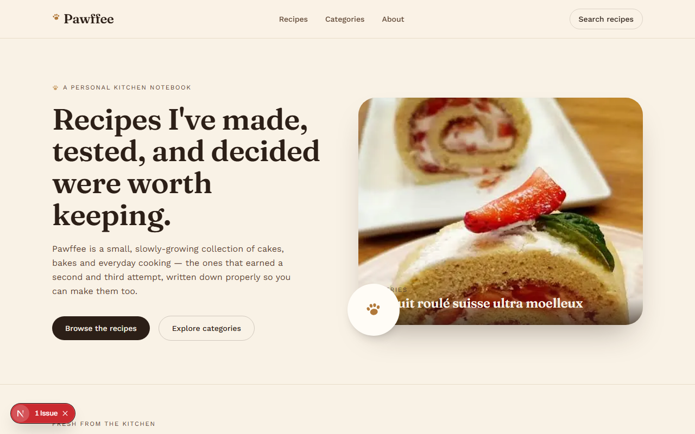

*Figure 1. The home page: a featured recipe next to the site's introduction, with a clear path to the library and the categories.*

## Contents

1. [What it does](#what-it-does)
2. [A tour of the public site](#a-tour-of-the-public-site)
3. [A tour of the admin area](#a-tour-of-the-admin-area)
4. [Technology stack](#technology-stack)
5. [Architecture](#architecture)
6. [Surviving free hosting: cold starts](#surviving-free-hosting-cold-starts)
7. [Running it locally](#running-it-locally)
8. [Configuration](#configuration)
9. [Deployment](#deployment)
10. [Updating the screenshots](#updating-the-screenshots)

## What it does

**For visitors**

- Browse every published recipe in a paginated library (12 per page).
- Search by recipe name, description, category, tag or ingredient, and filter by category.
- Read a recipe with a cover photo, an optional photo gallery, prep, rest, cook and total times, servings, difficulty and an estimated cost in Algerian dinars (DZD).
- Follow grouped ingredients next to numbered instructions, where any step can carry its own photo.
- Read five optional personal notes: before you start, my tips, my little secret, cooking notes and my verdict.
- Download any recipe as a formatted PDF for printing.
- Use the whole site comfortably on a phone.

**For me, as the only author**

- Write and edit recipes in a private admin area, and save them as drafts or publish them.
- Upload photos straight from the editor to Cloudinary or an S3 compatible bucket.
- Manage categories, and see what is published and what is still a draft at a glance.

**Behind the scenes**

- Drafts can never leak: the public queries filter on `status = 'published'` in SQL, not only in the interface.
- Every recipe page carries schema.org `Recipe` data so search engines can read it.
- A cold start handling system keeps the site pleasant on free hosting (see [Surviving free hosting](#surviving-free-hosting-cold-starts)).

## A tour of the public site

The figures below follow the path a visitor takes, from the first page to a finished recipe.

### Finding a recipe


*Figure 2. The library lists every published recipe as a card with its cover photo, category, a short description, difficulty and cost. A search box and a category dropdown sit above the grid.*


*Figure 3. Searching for "Biscuit" narrows the library to one recipe. The search looks at titles, descriptions, categories, tags and ingredient names, and the result count updates above the grid.*

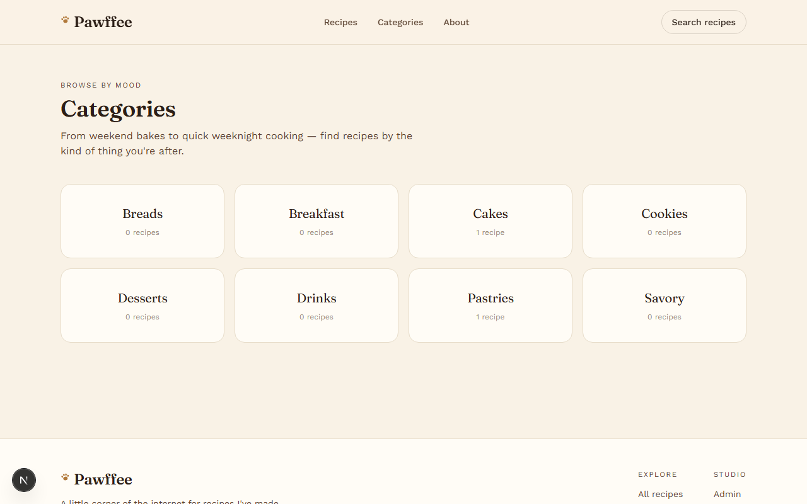

*Figure 4. Recipes are grouped the way I think about them: breads, breakfast, cakes, cookies, desserts, drinks, pastries and savory. Each card shows how many recipes it holds.*


*Figure 5. A category page lists its own recipes. An empty category, like this one, shows a friendly message instead of a blank page.*

### Reading a recipe


*Figure 6. The top of a recipe: breadcrumb back to the library and category, the title, a short description and the cover photo.*

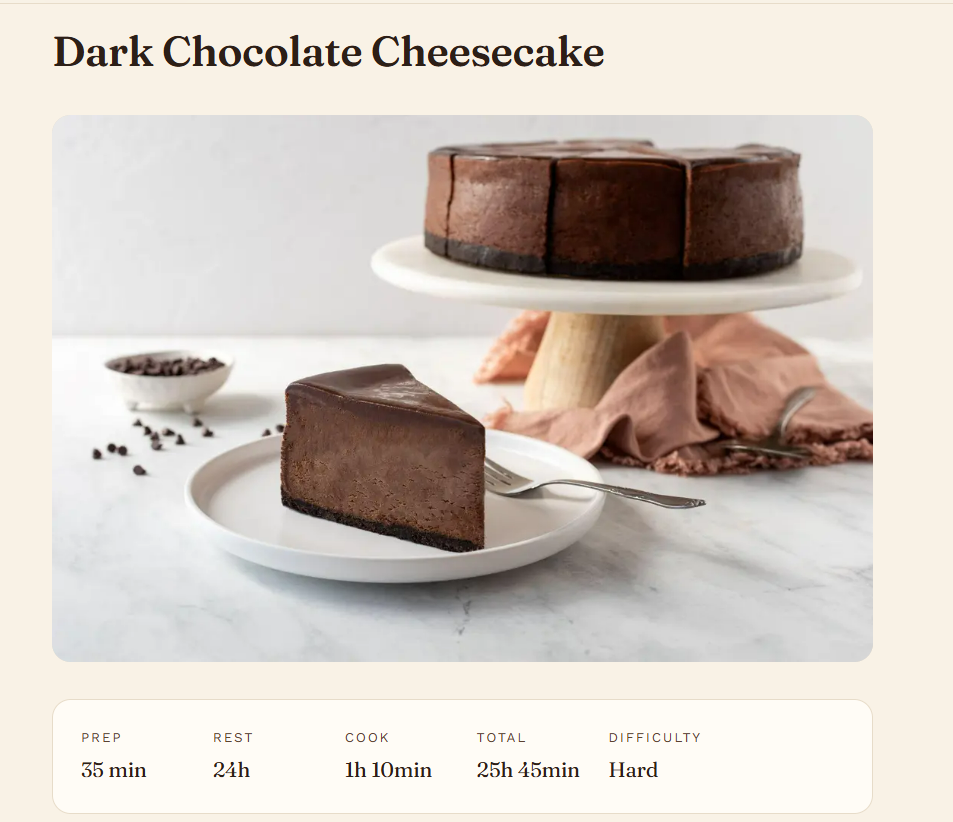

*Figure 7. Right under the photos, a summary bar gives prep, rest, cook and total time, plus the difficulty. This example is a dark chocolate cheesecake that needs a full day of resting, which is exactly the kind of detail worth knowing before you start.*


*Figure 8. The "Download recipe (PDF)" button. The file is generated on demand, so it always matches the current version of the recipe.*


*Figure 9. On a desktop, ingredients sit in a left column and the method on the right. The "Before you start" note appears above the numbered steps, so preparation advice is read first.*

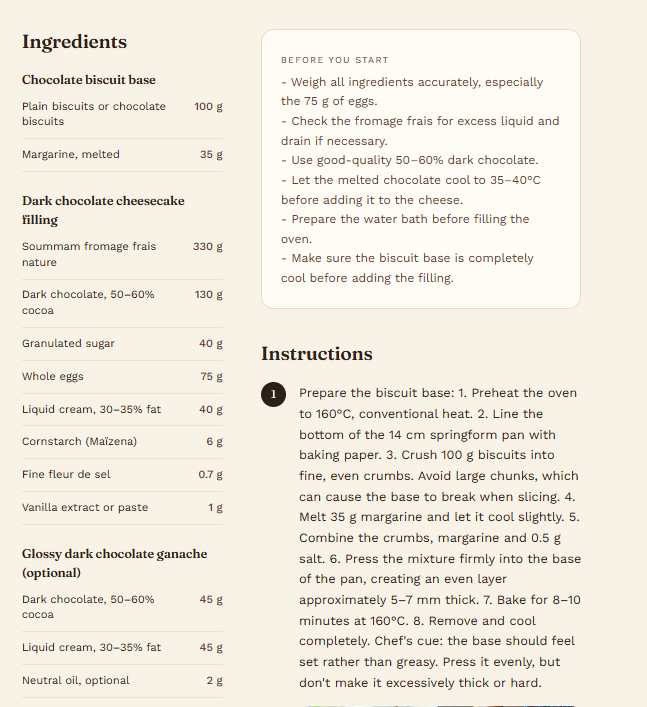

*Figure 10. Ingredients can be split into named groups (here: biscuit base, filling and ganache), each with its own quantities. This keeps long recipes with several components readable.*

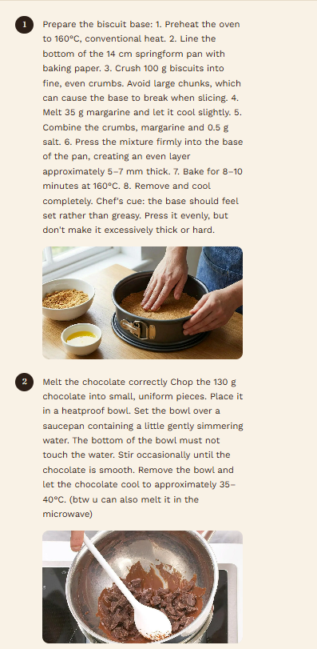

*Figure 11. Any step can have a photo. Here, pressing the biscuit base into the tin and melting the chocolate are both shown, so the technique is visible and not only described.*


*Figure 12. Further down, the numbered steps continue. The personal notes (tips, little secret, cooking notes and verdict) appear after the last step, and any note left empty is simply not shown.*

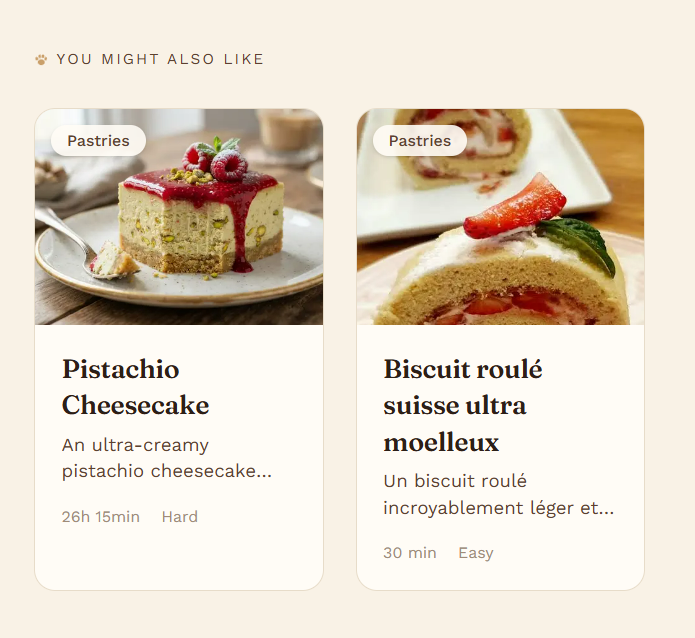

*Figure 13. At the bottom of a recipe, "You might also like" suggests other recipes from the same category.*

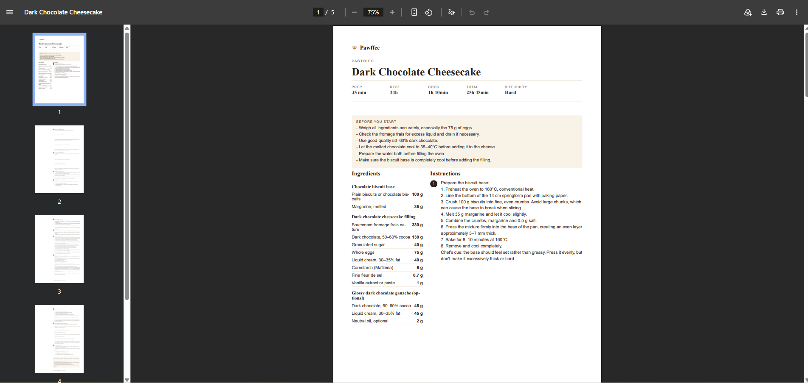

*Figure 14. The generated PDF: title and category, the times bar, the "Before you start" note, then ingredients and instructions in two columns, with a page number in the footer. This recipe runs to five pages.*

### The rest of the site


*Figure 15. The about page tells the story of the kitchen drawer this site grew out of.*

### On a phone

The layout adapts to small screens, and the top navigation collapses into a menu button.

<p>
  
  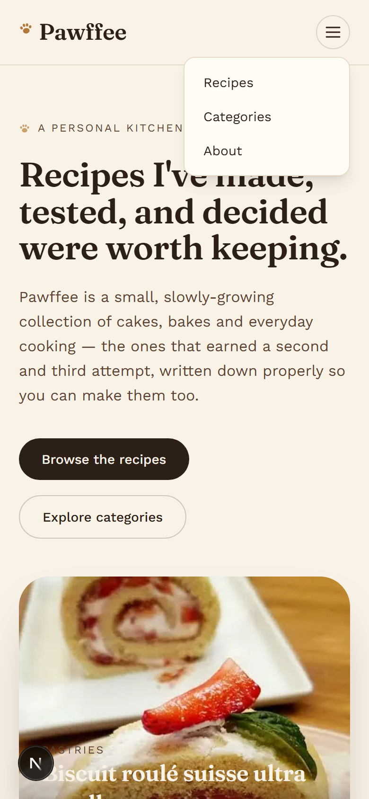
  
</p>

*Figures 16, 17 and 18, from left to right. The home page, the open navigation menu, and a recipe page on a phone. Text, buttons and photos resize to a single column.*

## A tour of the admin area

Everything below is private. The admin pages and the admin API are protected by a signed session cookie, so none of it can be reached without signing in.

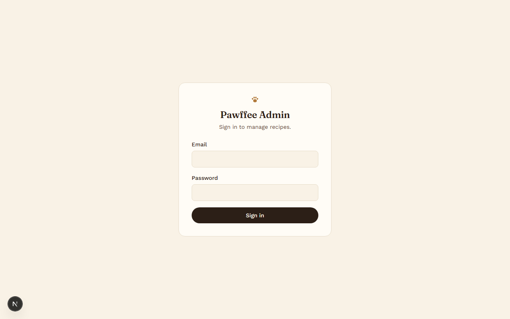

*Figure 19. The sign in page. Login attempts are rate limited and an incorrect password gives no hint about which field was wrong.*

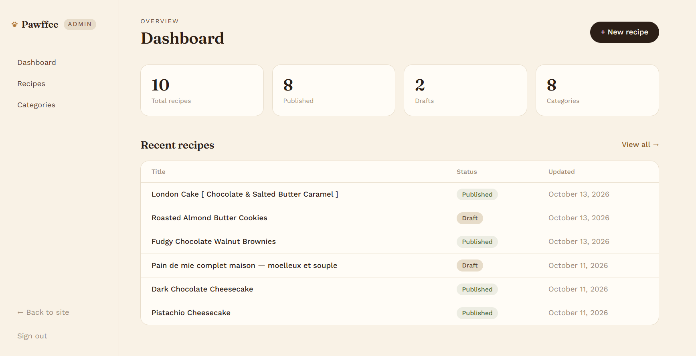

*Figure 20. The dashboard shows how many recipes exist, how many are published, how many are drafts and how many categories there are, followed by the most recently updated recipes with their status.*

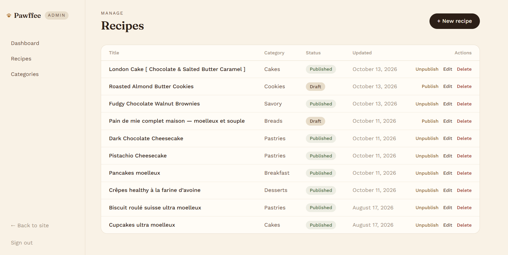

*Figure 21. The recipe list shows every recipe with its category, status and last update. From one row I can publish or unpublish, edit, or delete.*

The recipe editor is one long form, shown here in three parts.

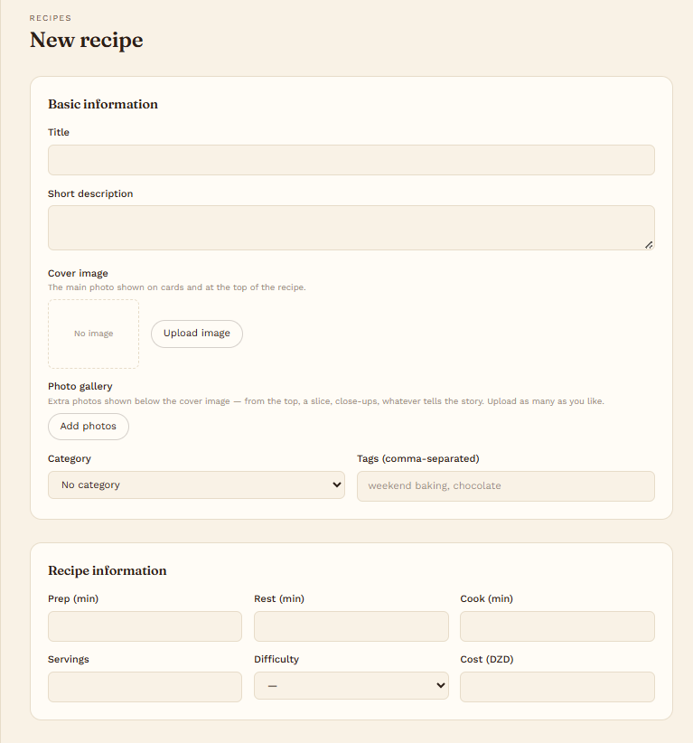

*Figure 22. Basic information: title, short description, cover image, photo gallery, category and tags, followed by prep, rest and cook times, servings, difficulty and cost in DZD.*

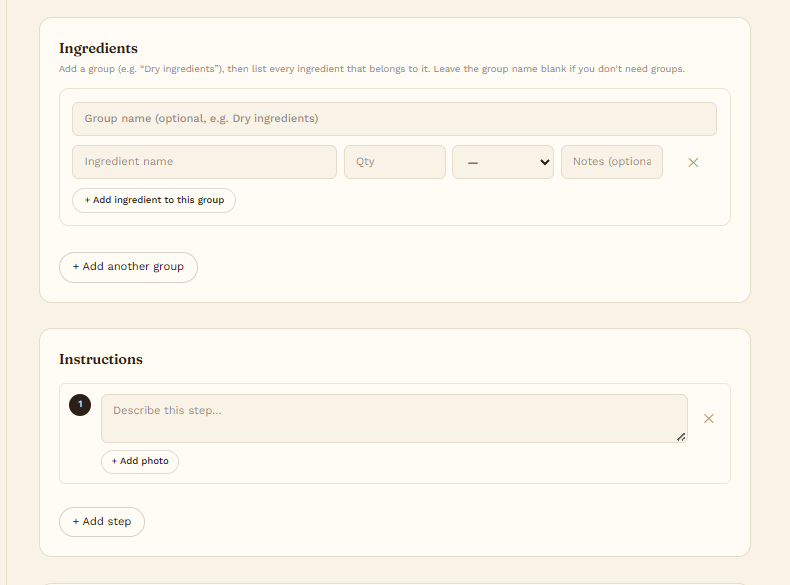

*Figure 23. Ingredients are added in groups, each line with a name, quantity, unit and optional note. Instructions are numbered steps, and every step can have a photo.*

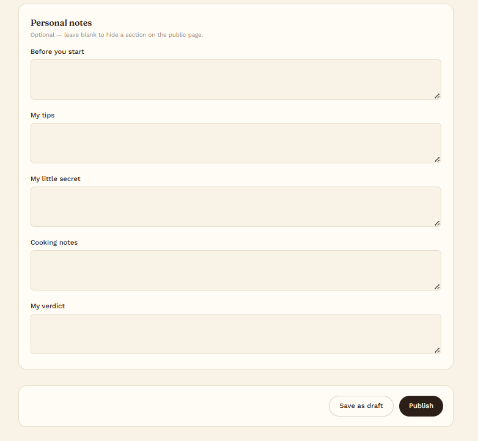

*Figure 24. The five optional personal notes, then the bottom bar with "Save as draft" and "Publish".*

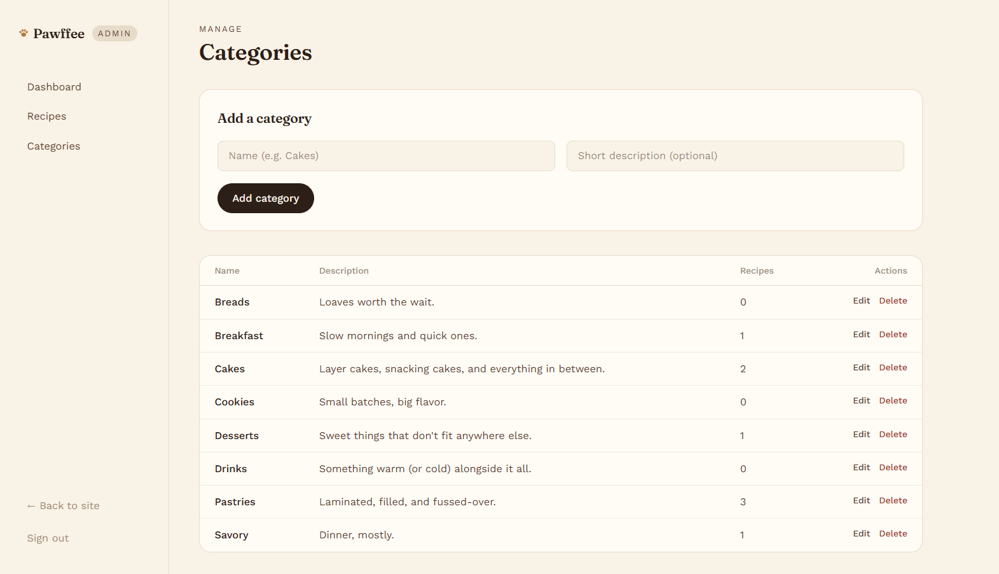

*Figure 25. The category manager: add a category with a name and a short description, and edit or delete existing ones. The recipe count per category is shown next to each.*

## Technology stack

| Layer | Technology | Why it is here |
| - | - | - |
| Framework | Next.js 16 (App Router), React 19 | Server rendered pages for fast loading and good search engine visibility, with API routes in the same project |
| Language | TypeScript | Catches mistakes between the database, the API and the interface before they reach a visitor |
| Styling | Tailwind CSS 4, Fraunces and Work Sans (self hosted with Fontsource) | A warm, consistent look with no external font requests |
| Database | PostgreSQL through `pg` | Recipes are relational: a recipe has ingredients, steps, groups and photos |
| Validation | Zod | One schema checks every recipe the admin sends to the API |
| Authentication | `jsonwebtoken` and `bcryptjs` | A signed session cookie and hashed passwords, enough for a single owner |
| Image storage | Cloudinary, or any S3 compatible bucket (`@aws-sdk/client-s3`) | Photos must survive redeploys, which local disk on a free host does not |
| PDF export | `@react-pdf/renderer` | Printable recipes generated on the server |
| Hosting | Render (web service), Neon or Supabase (Postgres), GitHub Pages (wake page) | A complete setup that costs nothing |
| Tooling | ESLint, `tsx`, Playwright (screenshots only) | Linting, running TypeScript scripts, and regenerating the README images |

## Architecture

### The big picture

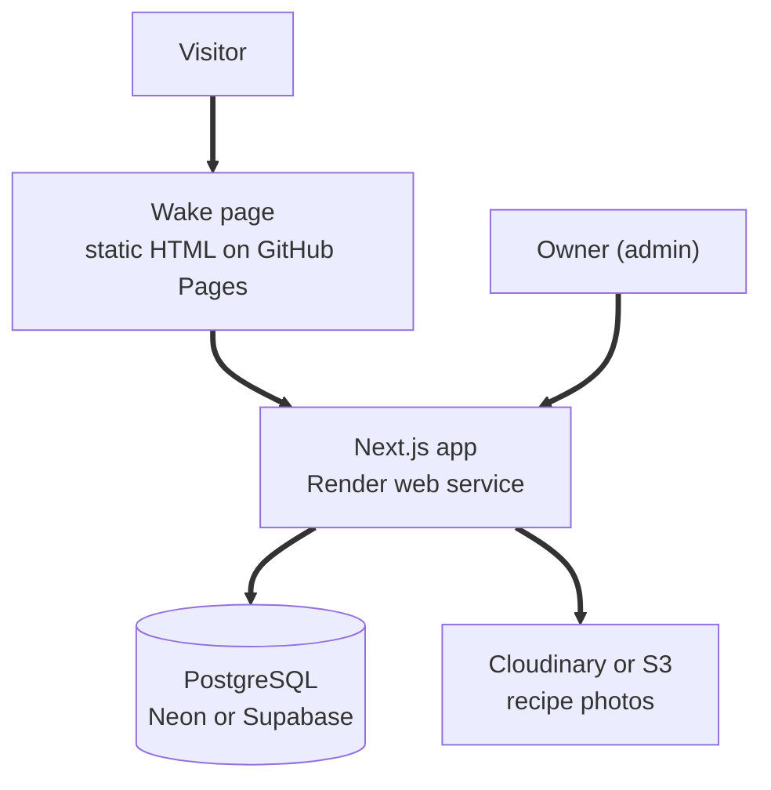

The Next.js app is the only piece of real logic. It reads and writes recipes in PostgreSQL and sends uploaded photos to external storage. The wake page is a separate static file that exists only to hide the cold start of the free server.

### Following a request: opening a recipe

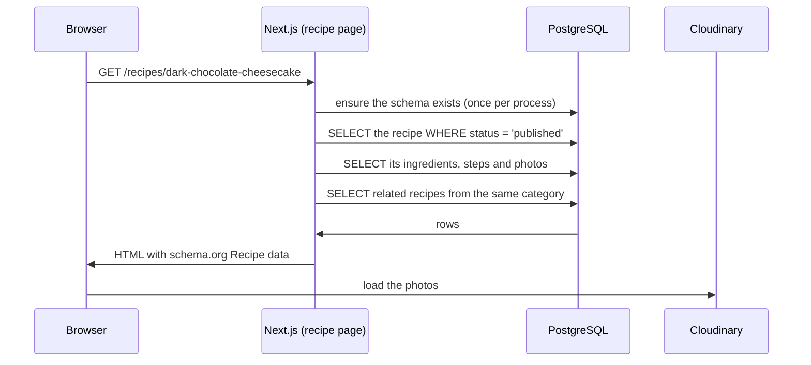

The page is rendered on every request (`force-dynamic`), so a recipe published from the admin area is visible immediately, with no rebuild.

### Following a request: saving a recipe

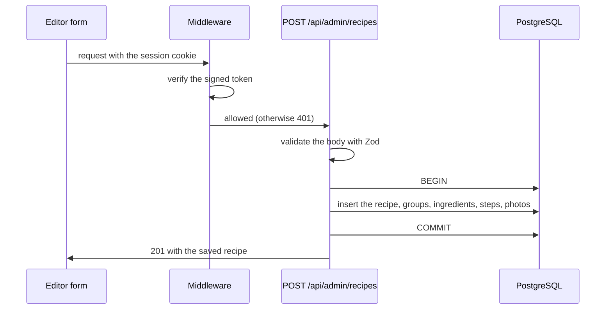

Because the whole save happens in one transaction, a recipe is never stored half written: either everything is saved or nothing is.

### Data model

| Table | What it holds | Notes |
| - | - | - |
| `recipes` | Title, unique slug, description, cover image, status, featured flag, times, servings, difficulty, cost in DZD, tags, and the five personal notes | `status` is limited to `draft` or `published`, `difficulty` to `easy`, `medium` or `hard`, both enforced by database constraints |
| `categories` | Name, unique slug, description | Deleting a category keeps its recipes and clears their category |
| `ingredient_groups` | A named group of ingredients and its position | Deleted with the recipe |
| `ingredients` | Name, quantity, unit, note, position, optional group | Deleted with the recipe |
| `steps` | Step text, optional photo, position | Deleted with the recipe |
| `recipe_images` | Gallery photos with an optional caption and position | Deleted with the recipe |
| `admin_users` | Email and bcrypt password hash | A single owner account |

The schema is created automatically the first time the app talks to the database (`ensureSchema`), and the result is cached for the life of the process.

### Folder layout

```
src/app/(site)       public pages: home, library, recipe, categories, about, PDF route
src/app/admin        private admin pages: login, dashboard, recipes, categories
src/app/api          route handlers: admin API (recipes, categories, upload, login, logout) and /api/health
src/components       shared interface pieces, plus the admin forms and tables
src/lib/data         all SQL for recipes and categories
src/lib              database pool, auth, validation, image storage, PDF, rate limiter, retry helper
src/middleware.ts    protects every /admin and /api/admin route
scripts              seed, set-admin and screenshots
wake                 the standalone wake page
docs                 setup notes and the screenshots used above
```

### Design decisions

| Decision | What it does | Why it matters |
| - | - | - |
| Drafts filtered in SQL | Public queries ask for `status = 'published'` directly | An unfinished recipe can never appear on a public page, even by guessing its address |
| Middleware on the Node runtime | Verifies the JWT for `/admin` and `/api/admin` before any page or handler runs | One place guards everything private, and a forgotten check in a single route cannot expose it |
| `SESSION_SECRET` is mandatory in production | The app refuses to start without it | A forgotten variable breaks the deploy loudly instead of quietly weakening security |
| Rate limited login | 8 attempts per 15 minutes per IP, kept in memory | Slows down password guessing on a small single instance |
| Cookie settings | `httpOnly`, `sameSite: lax`, `secure` in production, 7 day lifetime | The session token cannot be read by page scripts |
| Zod on every write | One schema shared by the form and the API | Bad data is rejected with a clear message before it touches the database |
| Image upload limits | JPEG, PNG, WebP or AVIF, 8 MB maximum | Keeps storage and bandwidth under control |
| Storage backends in order | Cloudinary, then S3 compatible, then local disk | Production uses durable storage, while local development works with no setup |
| Transactions for writes | Recipe and children saved together, children replaced on update | No half saved recipes |
| Retries only for reads | Connection and `SELECT` retried with growing delays, writes never rerun | A paused database causes a slow page, never a duplicated write |
| Server side PDF | `renderToBuffer` in a Node route | Recipes can be printed from any device, always up to date |
| schema.org JSON-LD | Name, image, times, yield, ingredients and steps on every recipe page | Search engines can show recipes as rich results |

## Surviving free hosting: cold starts

Pawffee runs on Render's free tier, and free web services go to sleep after about 15 minutes without a visit. The first request after that waits 30 to 60 seconds for the server to start, and a free Postgres database can pause in a similar way. Without any handling, a visitor sees a blank tab and sometimes an error page.

A sleeping server cannot show its own loading screen, because nothing is running to serve it. So the solution has two parts.

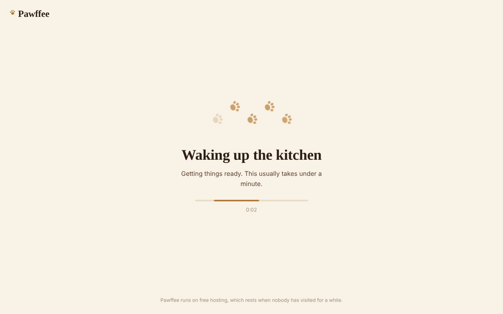

*Figure 26. The standalone wake page, shown while the server starts. Paw prints walk across the screen, a progress bar slides and a timer counts the seconds.*

**1. A standalone wake page** (the `wake` folder) is a single HTML file hosted somewhere that never sleeps, such as GitHub Pages. It asks the site whether it is awake, shows a friendly loading screen while it waits, and sends the visitor to the site the moment it responds. If the site has not come up after about two and a half minutes, it says so and offers a retry button. It also handles the visitor going offline, and `?to=/recipes/some-recipe` carries a deep link through the wait.

**2. Handling inside the app** covers everything that can still go wrong once the server is awake:

- `/api/health` reports whether the server and the database are up (`ok`, or `degraded` with a 503), and the call itself nudges a paused database to start waking.
- Pages show a loading skeleton straight away, and after four seconds they explain why it is slow.
- If a page fails to render, the error screen checks the health endpoint. When the cause looks like a cold start, it polls every three seconds (for about two minutes) and reloads by itself. Otherwise it offers a plain "Try again" button, which also prevents an endless reload loop.
- Database connections time out after 10 seconds and are retried up to four times with a growing delay. Only reads and the connection step are retried, so a write is never run twice.
- In the admin area, signing in and saving a recipe explain what is going on when the server is slow to answer.

### Setting up the wake page

1. Open `wake/index.html` and set the `pawffee-app-url` meta tag to your Render address.
2. On GitHub, go to Settings, then Pages, and choose GitHub Actions as the source. The workflow in `.github/workflows/wake-page.yml` publishes the page whenever the `wake` folder changes.
3. Share the Pages address as the public link to the site. Opening the Render address directly still works, it just cannot show the custom loading screen.

GitHub Pages only works for private repositories on paid plans. Any static host (Cloudflare Pages, Netlify and so on) can serve the `wake` folder just as well, since it is one file with no build step.

## Running it locally

You need Node.js and a PostgreSQL database (a local one, or a free Neon or Supabase project).

```bash
npm install
cp .env.example .env.local   # then fill in DATABASE_URL, SESSION_SECRET and the admin details
npm run seed                 # creates the tables, the admin account, categories and demo recipes
npm run dev
```

The site is then at `http://localhost:3000`. Without Cloudinary or S3 settings, uploaded photos are saved to `public/uploads`, which is fine for development.

| Script | What it does |
| - | - |
| `npm run dev` | Starts the development server |
| `npm run build` and `npm run start` | Builds and runs the production version |
| `npm run lint` | Runs ESLint |
| `npm run seed` | Creates the schema, the admin account, the categories and the demo recipes |
| `npm run set-admin` | Creates or updates the single admin account (email and password) |
| `npm run screenshots` | Regenerates the images in `docs/screenshots` |

## Configuration

| Variable | Required | Purpose |
| - | - | - |
| `DATABASE_URL` | Yes | PostgreSQL connection string |
| `PGSSL` | For most hosted databases | Set to `true` to connect over SSL |
| `SESSION_SECRET` | Yes in production | Long random string that signs the admin session cookie |
| `ADMIN_EMAIL` and `ADMIN_PASSWORD` | Once | Used by `npm run seed` or `npm run set-admin` to create the admin account |
| `CLOUDINARY_CLOUD_NAME`, `CLOUDINARY_API_KEY`, `CLOUDINARY_API_SECRET` | One storage option | Photo storage on Cloudinary (checked first), with an optional `CLOUDINARY_FOLDER` |
| `S3_BUCKET`, `S3_ACCESS_KEY_ID`, `S3_SECRET_ACCESS_KEY`, `S3_PUBLIC_URL_BASE` | The other storage option | Photo storage on any S3 compatible bucket, with optional `S3_REGION` and `S3_ENDPOINT` |

The full explanation of each variable, how to rotate the admin password and how to remove the demo recipes is in [docs/SETUP.md](docs/SETUP.md).

## Deployment

The repository includes a `render.yaml` blueprint. In short: create a free Postgres database on Neon or Supabase, create a Render Blueprint from this repository, fill in the environment variables, deploy, then run the seed once from your own machine against the remote database. Render's own free Postgres is not recommended because it expires after 30 days. The step by step guide is in [docs/SETUP.md](docs/SETUP.md).

## Updating the screenshots

The images in this README are numbered in reading order, so a figure can be replaced without touching the text around it. Some of them were captured by hand (for example the PDF and the step photos), and the rest can be regenerated. With the site running and seeded, `npm run screenshots` visits the pages, signs in to the admin area using the credentials in `.env.local` and rewrites the matching files in `docs/screenshots`. If Playwright is not installed yet, the command prints the two lines needed to add it without touching `package.json`. To photograph a deployed site instead of the local one, set `BASE_URL` first.

*A small personal project, not affiliated with any brand or business.*
