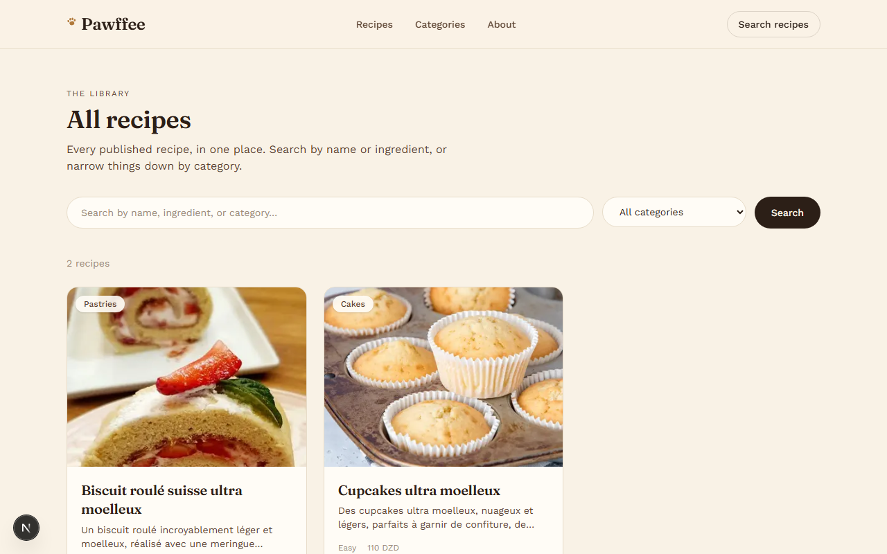
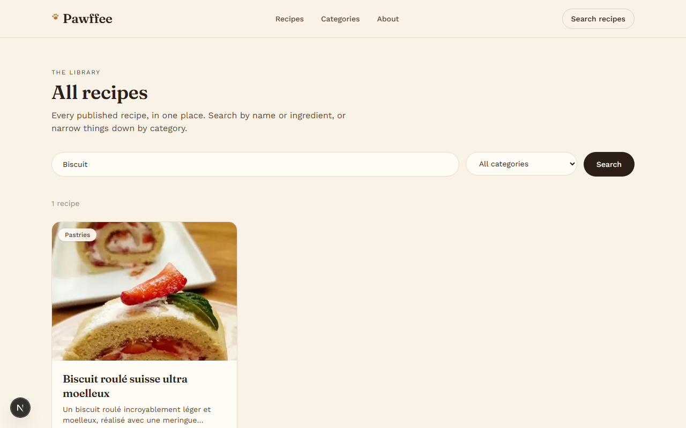
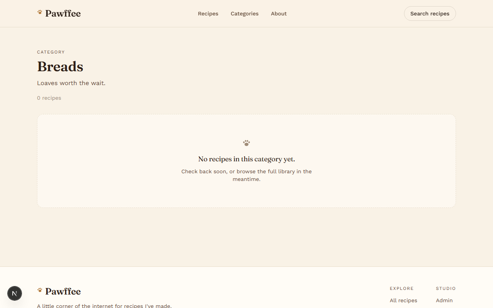
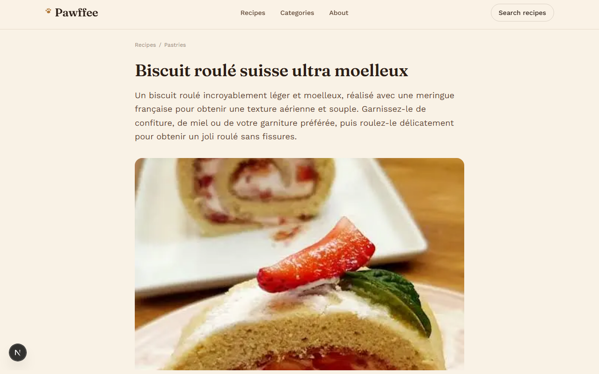
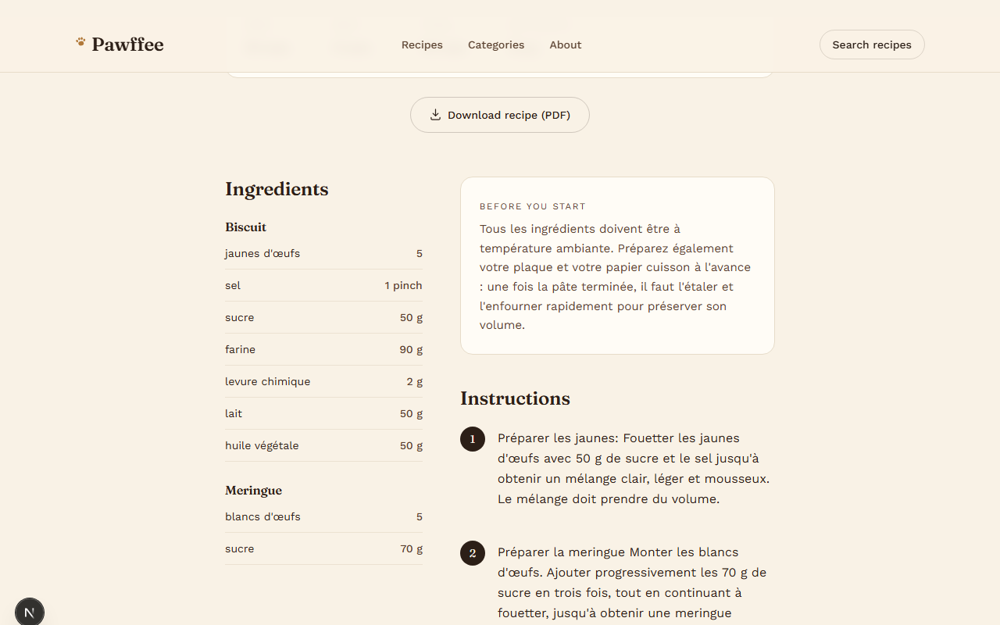
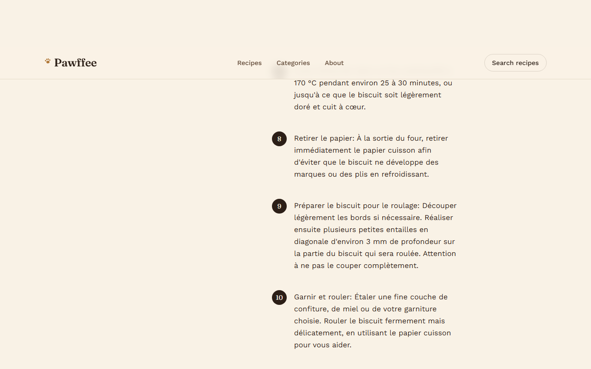
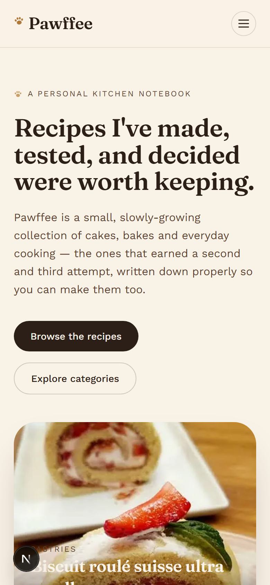
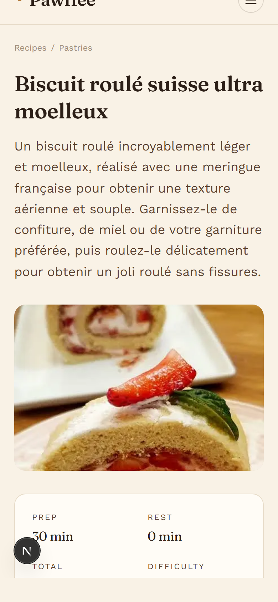
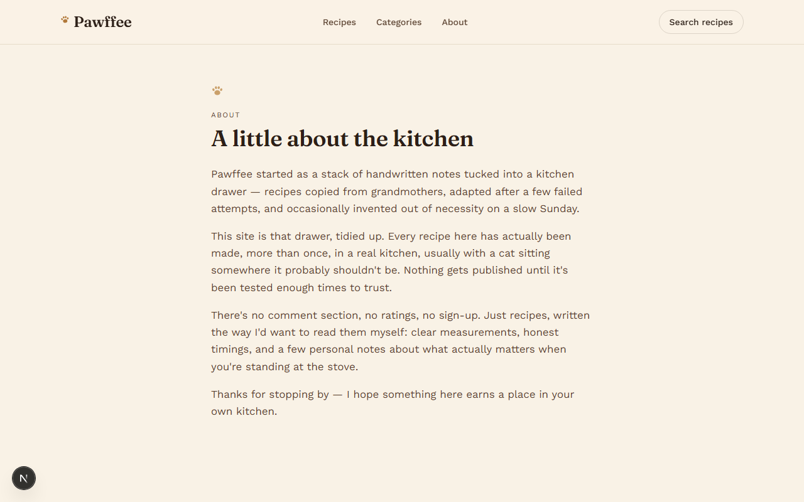

# Pawffee

*A digital home for recipes that almost didn't survive.*

For years my recipes lived on paper: in a drawer, in the margins of old notebooks, on index cards stained with butter and vanilla. Some got wet in the sink. Some got lost in a move. A few I only half remember now, and I still wonder what I got wrong the last time I made them.

Pawffee started as a way to fix that. It's not a food blog and it's not a business. It's a permanent home for the recipes I've actually made, tested, adjusted, ruined and eventually gotten right, along with the technique notes that never survive being scribbled on a card. Why a bake failed the first time, what changed the second time, the one small adjustment that turned a good recipe into one worth keeping.

It's also a small way to share all of that with other people: the successes and the failures, the little secrets, the things I've learned about pastry that don't usually make it into a recipe at all.


## What's in it

### The home page

A featured recipe up top, then the recipes I'm proudest of, the latest additions, and a row of categories with recipe counts.


### The recipe library

Every published recipe in one place, 12 to a page. You can search by name or ingredient and narrow things down with the category filter.



Searching for an ingredient or a recipe name:



### Categories

Recipes grouped the way I think about them: cakes, cookies, pastries, breads and so on. Each category has its own page.




### A recipe

Each recipe has a cover photo and an optional photo gallery, followed by prep, rest, cook and total times, servings, difficulty and an estimated cost in DZD. There is also a button that downloads the recipe as a PDF, generated on request, for printing.



Ingredients are split into groups (dry, wet, syrup and so on) and sit next to numbered instructions. A step can have its own photo.



### Notes from the kitchen

This is the part I care about most. Alongside the method, a recipe can carry five short notes: what to do before you start, my tips, my little secret, cooking notes and my verdict. Any note I leave empty simply doesn't show up. Related recipes appear at the bottom, and every recipe page includes schema.org Recipe data so search engines can read it.



### On a phone

The whole site is built to work on small screens, with a compact menu in place of the top navigation.

<p>
  
  
  
</p>

### About

A short page on why the site exists.



## The private side

Behind the scenes there's an admin area where I add and edit recipes. It's protected by a single admin login (rate limited, with a signed `httpOnly` session cookie), and drafts can't be reached from any public page.

**Sign in**


**Dashboard.** Totals for recipes, published, drafts and categories, plus the newest recipes.


**Recipe list.** Publish, unpublish, edit or delete from one table.


**Recipe editor.** Basic information, times and servings, grouped ingredients, step by step instructions with optional photos, a photo gallery and the personal notes. A recipe can be saved as a draft or published.


**Categories.** Add, rename and delete categories, with the number of recipes in each.


Photos are uploaded to Cloudinary or to any S3 compatible bucket. During local development they fall back to the local disk.

## Free hosting and cold starts

Pawffee runs on Render's free tier, and free web services go to sleep after about 15 minutes without a visit. The first request after that has to wait for the server to start, which takes anywhere from 30 to 60 seconds. A free Postgres database can pause in a similar way. Without any handling, that looks like a blank browser tab and then, sometimes, an error page.

A sleeping server can't show its own loading screen, because there's nothing running to serve it. So the fix has two parts.

**A standalone wake page** (the `wake` folder) is a single HTML file hosted somewhere that never sleeps, such as GitHub Pages. It asks the site whether it's awake, shows a friendly loading screen while it waits, and sends the visitor to the site the moment it responds. If the site hasn't come up after about two and a half minutes, it says so and offers a retry button. It also handles the visitor going offline, and `?to=/recipes/some-recipe` carries a deep link through the wait.


**Handling inside the app** covers everything that can still go wrong once the server is awake:

- `/api/health` reports whether the server and the database are up, and gives a paused database a nudge to start waking.
- Pages show a loading skeleton straight away instead of a blank screen, and after a few seconds they explain why it's slow.
- If a page fails to render, the error screen checks the health endpoint. When the cause looks like a cold start it waits and reloads by itself. Otherwise it offers a plain "Try again" button.
- Database connections have a timeout and retry a few times with a growing delay. Only reads and the connection step are retried, so a write is never run twice.
- In the admin area, signing in and saving a recipe explain what's going on when the server is slow to answer.

### Setting up the wake page

1. Open `wake/index.html` and set the `pawffee-app-url` meta tag to your Render address.
2. On GitHub, go to Settings, then Pages, and choose GitHub Actions as the source. The workflow in `.github/workflows/wake-page.yml` publishes the page whenever the `wake` folder changes.
3. Share the Pages address as the public link to the site. Opening the Render address directly still works, it just can't show the custom loading screen.

GitHub Pages only works for private repositories on paid plans. Any static host (Cloudflare Pages, Netlify and so on) can serve the `wake` folder just as well, since it's one file with no build step.

## Built with

- Next.js 16 (App Router), React 19 and TypeScript
- Tailwind CSS 4, with Fraunces and Work Sans served from the app itself
- PostgreSQL through `pg`, with request validation in Zod
- `@react-pdf/renderer` for the PDF downloads
- JWT sessions and bcrypt for the admin login
- Cloudinary or S3 compatible storage for photos
- Render for the web service, with a free Postgres from Neon or Supabase

## Running it locally

```bash
npm install
cp .env.example .env.local   # then fill in DATABASE_URL, SESSION_SECRET and the admin details
npm run seed                 # creates the tables, the admin account, categories and demo recipes
npm run dev
```

The site is then at `http://localhost:3000`. [docs/SETUP.md](docs/SETUP.md) covers the environment variables, changing the admin password and deploying to Render.

## How it's laid out

```
src/app/(site)     public pages
src/app/admin      the private admin area
src/app/api        route handlers (admin API and the health check)
src/components     shared UI
src/lib            database, auth, image storage, validation, PDF
scripts            seeding, admin account, screenshots
wake               the standalone wake page
docs               setup notes and the screenshots used above
```

## Updating the screenshots

The images in this README are generated, not hand made. With the site running and seeded, `npm run screenshots` visits every page, signs in to the admin area using the credentials in `.env.local` and rewrites everything in `docs/screenshots`. If Playwright isn't installed yet, the command prints the two lines needed to add it without touching `package.json`. To photograph a deployed site instead of the local one, set `BASE_URL` first.

*A small personal project, not affiliated with any brand or business.*
